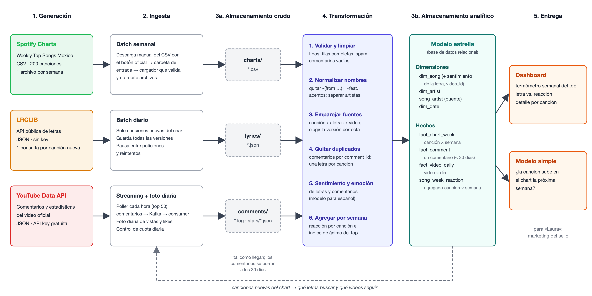

# RFC: Pulso emocional de la música en México

**Tarea 6 · RFC del proyecto final · Ingeniería de Datos**

**Autor:** Francisco Ortega (proyecto individual)

**Versión:** 1.1, 24 de noviembre de 2026 · **Estado:** revisado; los comentarios de la revisión están respondidos e incorporados (ver «Historial de cambios», al final de la sección 1)

---

## 1. Encabezado y enlaces (*Links*)

**Del proyecto**

- **Propuesta (Tarea 5):** https://drive.google.com/file/d/1jd5Sd-24zK124XBClo_7VXIMtxAUMhgc/view
- **Repositorio:** https://github.com/PancakesOS/Analisis-Sentimiento-Spotify. Tiene el código completo; el README explica cómo correrlo y registra las decisiones que se tomaron al construir.
- **Plataforma de la Tarea 4**, de donde reuso el consumer de Kafka y el processor con checkpoint: https://github.com/PancakesOS/Tarea-3.-BD-Spotify

**Documentación de las fuentes de datos**

- **Spotify Charts**, *Weekly Top Songs Mexico*: https://charts.spotify.com/charts/view/regional-mx-weekly/latest
- **Términos de uso de Spotify**, que aplican a Spotify Charts: https://www.spotify.com/legal/end-user-agreement/
- **LRCLIB**, API de letras: https://lrclib.net/docs
- **YouTube Data API v3:**
  - `search.list`: https://developers.google.com/youtube/v3/docs/search/list
  - `commentThreads.list`: https://developers.google.com/youtube/v3/docs/commentThreads/list
  - `videos.list`: https://developers.google.com/youtube/v3/docs/videos/list
  - Costo en cuota de cada método: https://developers.google.com/youtube/v3/determine_quota_cost
- **Políticas de YouTube para desarrolladores:** https://developers.google.com/youtube/terms/developer-policies
- **Política de métricas derivadas de YouTube:** https://developers.google.com/youtube/terms/derived-metrics-policy

**Recursos consultados para las decisiones** (detallados en la sección 5 b)

- Cambios a la Web API de Spotify (27 de noviembre de 2024): https://developer.spotify.com/blog/2024-11-27-changes-to-the-web-api
- *pysentimiento*, librería y artículo: https://github.com/pysentimiento/pysentimiento · https://arxiv.org/abs/2106.09462
- Técnicas de modelado dimensional de Kimball (grano, tipos de SCD, *snapshot* periódico): https://www.kimballgroup.com/data-warehouse-business-intelligence-resources/kimball-techniques/dimensional-modeling-techniques/
- Semántica de entrega de Kafka: https://kafka.apache.org/documentation/#semantics
- Streamlit: https://docs.streamlit.io
- Regresión logística en scikit-learn: https://scikit-learn.org/stable/modules/linear_model.html#logistic-regression

**Historial de cambios**

- **Versión 1.0 (19 de noviembre de 2026):** versión enviada a revisión.
- **Versión 1.1 (24 de noviembre de 2026):** incorpora la revisión de Joel Pérez (20 comentarios, todos respondidos en su hilo) y lo aprendido al construir:
  - el objetivo se enfoca en qué canciones del top usar en marketing y con qué tono (sección 2);
  - los trabajos batch corren cada hora en lugar de una vez al día (secciones 3, 6 y 7 d);
  - las canciones con letra en inglés quedan fuera del análisis de comentarios, porque sus videos juntan comentarios de todo el mundo (secciones 7 b y 9);
  - el modelo de datos documenta la llave sustituta `song_key`, la tabla `song_uri`, los artistas con coma en el nombre y las tablas del modelo y de la validación manual (sección 7 c);
  - la observabilidad dice cuánto se tarda en detectar una falla, y el dashboard avisa cuando falta descargar el chart (sección 7 f);
  - se agregan limitaciones (comentarios repetidos de una misma persona, sentimiento contra emoción, letras en dos idiomas, público global) y se aclara cómo comparar resultados entre instalaciones (sección 9);
  - se agrega un criterio de éxito de negocio y qué pasa si un criterio no se cumple (sección 10);
  - el plan se ajusta a la fecha de entrega, el lunes 7 de diciembre (sección 9).

---

## 2. Objetivo (*Objective*)

Voy a construir un flujo de datos de principio a fin para la coordinadora de marketing de un sello discográfico mexicano. Cada semana junta tres cosas por cada canción del top de Spotify México:

| Qué mide | Fuente |
|---|---|
| Cuánto se escucha | Spotify Charts |
| Qué dice la letra | LRCLIB |
| Cómo reacciona el público | Comentarios del video oficial en YouTube |

Sobre las letras y los comentarios calcula el sentimiento y la emoción. Con eso, un dashboard y un modelo simple le ayudan a decidir qué canciones del top usar en sus campañas de marketing (playlists, anuncios, contenido), cuáles están por subir y con qué tono comunicar cada una.

---

## 3. Objetivos específicos (*Goals*)

Al final del proyecto, el sistema:

1. **Chart.** Carga sin duplicados al menos 12 semanas de historia del chart semanal de México (se cargaron 54) y cada semana nueva que se deje en la carpeta de entrada.
2. **Letras.** Tiene la letra y su sentimiento para al menos el 85 % de las canciones distintas que aparecen en el chart.
3. **Comentarios.** Recibe por Kafka, cada hora, los comentarios nuevos del video oficial de cada canción del top 50 vigente. Un comentario publicado aparece en el dashboard en 2 horas o menos mientras la Mac está encendida. Todo el sistema revisa cada hora, así que una canción o un comentario nuevos no esperan a un horario fijo del día.
4. **Estadísticas.** Guarda una foto diaria de las vistas, likes y número de comentarios de cada video seguido.
5. **Preguntas de negocio.** Responde las 7 preguntas de Laura (sección 7 b) con consultas sobre el modelo estrella, una vista SQL por pregunta.
6. **Dashboard.** Muestra cada una de las 7 respuestas en un dashboard que Laura abre en el navegador.
7. **Modelo.** Incluye un modelo que estima si una canción sube en el chart la semana siguiente, con su evaluación comparada contra un *baseline*.
8. **Robustez.** Cada etapa se puede correr dos veces sin duplicar datos y deja en su `.log` qué hizo.
9. **Reproducibilidad.** Otra persona levanta el sistema desde un clon del repo siguiendo el README.
10. **Retención.** Cumple las políticas de YouTube: ningún texto de comentario se guarda más de 30 días.

---

## 4. Lo que queda fuera (*Non-Goals*)

| Fuera de alcance | Por qué |
|---|---|
| Otros países o los charts por ciudad | Cada chart es una descarga manual más por semana. El modelo deja lista una dimensión de país para agregarlos después. |
| Descargar el chart de forma automática | Los términos de Spotify Charts prohíben el acceso automatizado. |
| Comentarios del top 200 completo | La cuota de YouTube (10,000 unidades al día) alcanza con holgura para el top 50, no para el top 200 cada hora. |
| Respuestas a comentarios | Duplican el costo en cuota y repiten la conversación del comentario original. Solo uso los comentarios principales. |
| Actualización en tiempo real (por minuto) | Laura decide una vez por semana; una latencia de 2 horas le basta. |
| Otras redes (TikTok, Instagram, X) | No tienen una API gratuita y legal para leer comentarios ahora mismo. |
| Analizar el audio de las canciones | Spotify ya no da las *audio features* a apps nuevas, y analizar audio requiere los archivos. |
| Entrenar mi propio modelo de sentimiento | No hay datos etiquetados ni tiempo. Uso un modelo preentrenado para español. |
| Nube, usuarios o login en el dashboard | Es para una sola persona y corre en local con Docker. |

---

## 5. Contexto (*Background*)

### a) El problema

**Mi «Laura»** coordina marketing y playlists en un sello discográfico mexicano. Cada semana decide en qué 3 a 5 canciones invierte el presupuesto de promoción y con qué tono arma cada campaña.

**Su decisión:** *"¿Qué canciones promuevo esta semana y con qué tono?"*

Las canciones del chart ya son éxitos; la decisión de Laura no es si una canción funciona, sino a cuáles de las que ya están arriba les pone presupuesto, cuáles están por subir y con qué tono arma cada campaña.

**Por qué hoy no puede:**

- **El chart no dice qué transmite una canción.** Dice cuánto se escucha, pero no qué transmite la letra ni cómo reacciona la gente.
- **Spotify retiró la métrica de ánimo.** Desde noviembre de 2024 ya no da a apps nuevas las *audio features* (`valence`, `energy`), que eran la forma estándar de medir qué tan alegre suena una canción.
- **Nadie lee los comentarios de forma sistemática.** Los comentarios de YouTube son miles por video.
- **Las tres fuentes nombran distinto a la misma canción.** El #1 de la semana del 12 de noviembre aparece:
  - en el chart: "Suzuki (from GTAVI: The Album)", de "Fuerza Regida, Grand Theft Auto VI";
  - en LRCLIB: 16 versiones;
  - en YouTube: como primer resultado, el video de un canal de letras, no el oficial.

**Lo que aprendí desde la Tarea 5:**

- **El sello sirve para encontrar el video oficial.** La columna `source` del CSV identifica al sello, y el canal que subió el video oficial de "Suzuki" es justamente el de ese sello, Atlantic Records.
- **Hay un límite legal para guardar comentarios.** Las políticas de YouTube no permiten guardar el texto de los comentarios más de 30 días sin refrescarlo o borrarlo; esto cambió el diseño del almacenamiento (sección 7 c).
- **No toda la información se puede recuperar después.** Los comentarios antiguos se pueden pedir después porque cada uno trae su fecha. En cambio, las vistas de un día que ya pasó no: la API solo da el total actual. Por eso agregué una foto diaria de estadísticas.

### b) Referencias

| Referencia | Dónde | Qué decisión sustenta |
|---|---|---|
| Términos de Spotify y reglas de Spotify Charts | spotify.com/legal y el aviso «Rules of the road» que muestra charts.spotify.com al iniciar sesión | La descarga del CSV es **manual** y el pipeline automatiza todo a partir de la carpeta de entrada. Los CSV no se suben al repo, porque los términos prohíben redistribuirlos. |
| Cambios a la Web API de Spotify (2024) | developer.spotify.com/blog | Por qué no uso la API de Spotify: las *audio features* y las playlists editoriales ya no están disponibles para apps nuevas. Por eso mido el ánimo con letras y comentarios. |
| Documentación de LRCLIB | lrclib.net/docs | Uso `GET /api/search`, que no pide key y regresa todas las versiones. Por eso necesito una regla para elegir la versión correcta. |
| Costos de cuota de YouTube Data API | developers.google.com/youtube/v3/determine_quota_cost | El presupuesto de cuota (sección 7 d): `search.list` cuesta 100 unidades, así que el video de cada canción se busca **una sola vez**; `commentThreads.list` y `videos.list` cuestan 1. |
| Políticas de YouTube para desarrolladores y de métricas derivadas | developers.google.com/youtube/terms | El texto de los comentarios se borra a los 30 días y solo se conservan agregados. Las estadísticas (vistas, likes) sí se pueden guardar más tiempo. |
| pysentimiento (Pérez et al., 2021) | github.com/pysentimiento · arXiv 2106.09462 | Elijo un modelo preentrenado con tweets en español, que maneja jerga y emojis. Da polaridad (positivo, neutro, negativo) y emoción, corre local y sin costo, y su versión se puede fijar para ser reproducible. |
| Técnicas de modelado dimensional de Kimball | kimballgroup.com | Grano de cada hecho, tabla puente canción–artista, SCD tipo 1 en las dimensiones y `fact_video_daily` como *snapshot* periódico. |
| Semántica de entrega de Kafka | kafka.apache.org/documentation | Entrega al menos una vez: el offset se confirma después de escribir. Los duplicados se eliminan en la base con `comment_id` como llave primaria. |
| Mi plataforma de la Tarea 4 | Repo enlazado arriba | Reuso el consumer con `store_offsets` después de escribir y el processor con checkpoint por byte, que ya validé de principio a fin. Eso baja el riesgo en un proyecto individual de 4 semanas. |

### c) Estado actual (18 de noviembre; actualizado el 24)

**Al 24 de noviembre** todas las etapas funcionan de principio a fin y están en el repositorio: 54 semanas del chart, 658 de 663 canciones con letra, 741,376 comentarios analizados, las 7 vistas, el dashboard y el modelo. Los valores medidos están en la sección 10. Lo que sigue es lo que había el 18 de noviembre.

**Ya probado o existente**

- **CSV del chart:** descargué la semana del 6 al 12 de noviembre de 2026, con 200 filas y 9 columnas. Contiene:
  - 24 canciones con `previous_rank = -1`;
  - 83 canciones con varios artistas.
- **LRCLIB:** encontró letra para **10 de 10** canciones del top 10, en 0.34 s promedio por consulta.
- **API key de YouTube:** creada y restringida a la YouTube Data API.
  - **Búsqueda:** encontré el video oficial de "Suzuki" (`wROPn_SFE5s`, con 1,142 comentarios).
  - **Comentarios:** bajé 100 comentarios en 0.55 s, por 1 unidad de cuota.
- **Plataforma de la Tarea 4:** PostgreSQL 18, Kafka 4.1 en modo KRaft, el consumer y el processor con cron funcionan y están validados.
- **Repositorio:** creado, con la estructura inicial y este RFC.

**Todavía no existe**

- Los programas de ingesta de este proyecto, el esquema estrella, el emparejamiento, el análisis de sentimiento, el dashboard y el modelo.
- No he medido cuántos comentarios por segundo procesa el modelo de sentimiento en mi Mac. Lo mediré en la semana 3 (sección 10).

---

## 6. Panorama general (*Overview*)



El sistema tiene cinco piezas, todas en contenedores de un mismo `docker-compose.yml`:

| Pieza | Qué hace | Cada cuánto |
|---|---|---|
| **Ingesta batch** (cron) | Carga los CSV del chart que aparecen en la carpeta de entrada, pide las letras de canciones nuevas a LRCLIB, busca el video oficial de cada canción del top 50 y toma la foto diaria de estadísticas | Cada 15 minutos (chart), cada hora (letras y videos) y cada 10 minutos (revisión de la foto del día) |
| **Ingesta streaming** (producer + Kafka + consumer) | Un *poller* pide cada hora los comentarios nuevos y los publica en el tópico `youtube_comments`. El consumer los escribe en la zona cruda. | Continuo |
| **Zona cruda** (volumen de Docker) | Guarda los archivos tal como llegan: CSV, JSON y `.log` | — |
| **Transformación** (cron + PostgreSQL) | Limpia, empareja canción–letra–video, quita duplicados, calcula el sentimiento y carga el modelo estrella | Cada hora |
| **Entrega** | Un dashboard en Streamlit lee vistas SQL; un modelo de regresión logística se reentrena cuando cambian sus datos | Siempre encendido; el modelo revisa cada hora |

**Cómo fluyen los datos:**

1. El chart es la fuente maestra. Cuando entra una canción nueva:
   - se crea en `dim_song`;
   - en la siguiente hora el sistema busca su letra;
   - si está en el top 50, busca su video.
2. Desde ese momento, el *poller* sigue los comentarios del video.
3. Los comentarios se analizan apenas llegan, y su reacción se agrega por canción y semana.
4. El dashboard cruza esa reacción con la posición en el chart y con el sentimiento de la letra.

---

## 7. Diseño detallado (*Detailed Design*)

### a) Fuentes de datos

| Fuente | Qué es | Formato | Cómo se obtiene | Cada cuánto | Cuántos datos |
|---|---|---|---|---|---|
| Spotify Charts | Top 200 semanal de México (viernes a jueves) | CSV: `rank, uri, artist_names, track_name, source, peak_rank, previous_rank, weeks_on_chart, streams` | Descarga manual con el botón oficial a `data/landing/charts/` | 1 archivo por semana | 200 filas (~25 KB); se cargaron 54 semanas = 10,799 filas |
| LRCLIB | Letras de canciones | JSON: `id, trackName, artistName, albumName, duration, instrumental, plainLyrics, syncedLyrics…` | `GET https://lrclib.net/api/search?track_name=…&artist_name=…`, sin key | Una vez por canción nueva | ~400–500 canciones al inicio, después ~10–30 por semana; 2 a 20 versiones por búsqueda |
| YouTube: comentarios | Comentarios principales del video oficial | JSON: `commentThreads` (`id, videoId, textOriginal, likeCount, publishedAt, totalReplyCount`) | `commentThreads.list`, ordenados por fecha, 100 por página, con API key | Cada hora (top 50 vigente); diario (resto de videos seguidos) | Se juntaron 741,376; el 73 % era de un solo video global («SWIM» de BTS), que quedó fuera por la regla de idioma (sección 7 b) |
| YouTube: estadísticas | Vistas, likes y número de comentarios de cada video | JSON: `videos` (`statistics.viewCount, likeCount, commentCount`) | `videos.list`, hasta 50 videos por llamada | Una vez al día | 1 fila por video y día; ~120 videos |
| YouTube: búsqueda | El video oficial de cada canción | JSON: `search` (`videoId, channelTitle, title`) | `search.list` | Una vez por canción que entra al top 50 | ~120 búsquedas en la historia; después ~5–10 por semana |

### b) Preguntas de negocio y cómo se responde cada una

La semana de cada comentario es la **semana del chart** (viernes a jueves) que contiene su fecha en hora de México (`America/Mexico_City`).

En los ejemplos, los datos del chart son reales, de la semana del 12 de noviembre. **Los valores de sentimiento y reacción son ilustrativos**, porque todavía no se calculan.

**Qué comentarios cuentan.** Solo los de canciones con la letra en español. Las canciones con letra en inglés (BTS, Taylor Swift, villancicos) quedan fuera de las preguntas de letras y también de las de comentarios: sus videos juntan comentarios de todo el mundo, en inglés y coreano, que el modelo en español no entiende y que no representan al público de México. Una canción del top sin video oficial (ni audio oficial del canal del artista o del sello) queda sin reacción: no se toma un video de fans, y el dashboard la muestra como «sin reacción medible».

**Sentimiento y emoción se muestran por separado.** Un «me hizo llorar» en una canción triste puede salir negativo aunque sea un elogio. Por eso el dashboard enseña la emoción dominante (tristeza no es rechazo) junto al sentimiento, y la calidad del sentimiento se mide contra 100 comentarios etiquetados a mano (sección 10).

**P1. "¿Qué canciones del top 50 de esta semana tienen la reacción más positiva del público?"**

- **Tablas:** `fact_chart_week` (`rank`) ⨝ `song_week_reaction` (`n_comments`, `pct_pos`, `pct_neg`) ⨝ `dim_song` (`track_name`, `main_artist`).
- **Filtro:** la semana más reciente, `rank <= 50` y `n_comments >= 20`, para no premiar canciones con 3 comentarios.

| rank | track_name | main_artist | n_comments | pct_pos | pct_neg |
|---|---|---|---|---|---|
| 6 | Nalguita y Teta | Neton Vega | 214 | 78 % | 9 % |
| 2 | BbY WOW | KAROL G | 530 | 71 % | 12 % |
| 1 | Suzuki (from GTAVI: The Album) | Fuerza Regida | 388 | 58 % | 21 % |

**P2. "Las canciones que la gente recibe bien en YouTube, ¿suben en el chart la semana siguiente?"**

- **Tablas:** `song_week_reaction` de la semana *w* ⨝ `fact_chart_week` de la semana *w* y de *w + 1*.
- **Variable objetivo:** `subio = rank(w+1) < rank(w)`.
- **Respuesta:** una tabla por quintil de reacción, más la evaluación del modelo (sección 7 d).

| quintil de pct_pos en la semana w | canciones | % que subió en w + 1 |
|---|---|---|
| 1 (reacción más negativa) | 96 | 31 % |
| 5 (reacción más positiva) | 96 | 47 % |

**P3. "¿El top de México está más triste o más alegre que hace un mes?"**

- **Tablas:** `fact_chart_week` ⨝ `dim_song` (`lyrics_score = p_pos − p_neg` de la letra).
- **Índice de ánimo:** `Σ(streams × lyrics_score) / Σ(streams)` sobre el top 50 de cada semana.

| semana (termina) | índice de ánimo (−1 a 1) | cambio contra 4 semanas antes |
|---|---|---|
| 2026-10-15 | 0.12 | — |
| 2026-11-12 | −0.04 | −0.16 |

**P4. "¿Qué artistas tienen letras negativas pero un público feliz?"**

- **Tablas:** `song_artist` ⨝ `dim_artist` ⨝ `dim_song` (`lyrics_score`) ⨝ `song_week_reaction` (`avg_score`).
- **Filtro:** artistas con 2 o más canciones en el periodo, `AVG(lyrics_score) < 0` y `AVG(avg_score) > 0.2`.

| artist_name | canciones | lyrics_score promedio | reacción promedio |
|---|---|---|---|
| Victor Mendivil | 15 | −0.41 | 0.35 |

El número de canciones es real: Victor Mendivil aparece en 15 de las 200 canciones de la semana del 12 de noviembre, en 12 como artista principal y en 3 como invitado. Por eso la tabla puente es necesaria: si solo se guardara el artista principal, se perderían sus colaboraciones.

**P5. "¿Cuántas semanas aguanta en el top una canción con letra positiva contra una con letra negativa?"**

- **Tablas:** `fact_chart_week` (`MAX(weeks_on_chart)` por `uri`) ⨝ `dim_song` (`lyrics_sentiment`).
- **Medidas:** mediana y promedio por grupo de sentimiento.

| lyrics_sentiment | canciones | mediana de semanas en el chart |
|---|---|---|
| POS | 140 | 9 |
| NEG | 110 | 12 |

**P6. "De las canciones que entraron nuevas esta semana, ¿cuáles generan más conversación y con qué emoción?"**

- **Tablas:** `fact_chart_week` (`previous_rank IS NULL AND weeks_on_chart = 1`, es decir, un debut) ⨝ `song_week_reaction` (`n_comments`, `dominant_emotion`) ⨝ `fact_video_daily` (vistas ganadas en la semana).

| rank | track_name | n_comments | vistas ganadas | emoción dominante |
|---|---|---|---|---|
| 107 | MAÑA | 160 | 1.2 M | alegría |
| 112 | Cuando Yo Me Muera | 95 | 0.8 M | tristeza |

**P7. "¿Cómo reacciona el público a las canciones de mi sello comparado con los otros sellos?"**

- **Tablas:** `dim_song` (`label`, que viene de `source`) ⨝ `fact_chart_week` (`streams`) ⨝ `song_week_reaction` (`avg_score`, ponderado por número de comentarios).

| label | canciones en el top 200 | % de streams | reacción promedio |
|---|---|---|---|
| Josa Records | 10 | 7.1 % | 0.41 |
| Atlantic Records | 2 | 2.7 % | 0.22 |

Aquí las columnas de canciones y % de streams son reales (semana del 12 de noviembre). El sello hay que normalizarlo: en el mismo CSV aparecen "Josa Records" y "Josa Records (Neton Vega)".

### c) Modelo de datos

**Hechos**

| Tabla | Grano | Medidas | Llave |
|---|---|---|---|
| `fact_chart_week` | Una canción en una semana del chart | `streams` (aditiva entre canciones); `rank`, `peak_rank`, `previous_rank` (`NULL` si venía `-1`) y `weeks_on_chart` (no aditivas) | (`week_key`, `song_key`) |
| `fact_comment` | Un comentario principal | `like_count` y `reply_count` (al ingerir); `p_pos`, `p_neu`, `p_neg`; `score = p_pos − p_neg` | `comment_id` |
| `fact_video_daily` | Un video en un día (*snapshot* periódico) | `view_count`, `like_count`, `comment_count`, acumulados al momento de la foto | (`date_key`, `song_key`) |
| `song_week_reaction` | Una canción en una semana (agregado) | `n_comments`, `pct_pos`, `pct_neu`, `pct_neg`, `avg_score`, `dominant_emotion` | (`week_key`, `song_key`) |

Columnas descriptivas de `fact_comment`: `song_key`, `video_id`, `date_key`, `published_at`, `ingested_at`, `text_original`, `sentiment`, `emotion`, `model_version` y `discarded` (comentario de un video que resultó no ser el oficial, o de una canción con letra en inglés). **No guarda ningún dato del autor.** `song_week_reaction` guarda además `last_ingested_at`, para saber qué parejas canción–semana recalcular sin un archivo de estado.

**`song_key` es una llave sustituta** que asigna PostgreSQL al cargar (identity), así que en otra instalación la misma canción puede tener otro número. La llave natural es la URI de Spotify, y es la que hay que usar para comparar resultados entre instalaciones. Spotify a veces le cambia la URI a una canción que ya está en el chart, así que una canción puede tener varias URI (tabla `song_uri`).

**Dimensiones**

| Tabla | Columnas |
|---|---|
| `dim_song` | `song_key`, `spotify_uri` (la primera URI vista), `track_name`, `track_name_norm`, `main_artist_key`, `label` (de `source`), `label_norm`, `youtube_video_id`, `video_match` (`auto`, `review` o `manual`), `video_checked_at`, `lyrics_status` (`found`, `not_found` o `instrumental`), `lyrics_checked_at`, `lrclib_id`, `lyrics_language`, `lyrics_sentiment`, `lyrics_p_pos`, `lyrics_p_neu`, `lyrics_p_neg`, `lyrics_emotion`, `model_version`, `first_seen_week`, `updated_at` |
| `song_uri` | `spotify_uri` (única), `song_key`: todas las URI con que aparece cada canción |
| `dim_artist` | `artist_key`, `artist_name`, `artist_name_norm` (única) |
| `song_artist` (puente) | `song_key`, `artist_key`, `artist_order` (1 = artista principal). Los artistas se separan por la coma de `artist_names`, salvo una lista de nombres que llevan coma («Tyler, The Creator», «Earth, Wind & Fire»), que no se parten |
| `dim_date` | `date_key` (AAAAMMDD), `date`, `chart_week_end` (el jueves de su semana), `month`, `year` |

**Tablas de control**, que no forman parte de la estrella:

| Tabla | Qué guarda |
|---|---|
| `etl_loaded_file` | Nombre, sha256 y filas de cada CSV cargado |
| `etl_quota_usage` | Unidades de cuota gastadas por día |
| `video_watermark` | Fecha del comentario más reciente ya leído de cada video, avance de la carga histórica y si el video tiene los comentarios desactivados |

**Tablas de resultados**, que tampoco son parte de la estrella: `model_run` y `model_prediction` (métricas, coeficientes y probabilidad de subir de cada canción) y `sentiment_label` y `video_check` (la validación manual de la sección 10; `sentiment_label` guarda el id del comentario y las etiquetas, nunca el texto).

**Idioma de la letra (`lyrics_language`).** Se decide por la mayoría de palabras comunes de cada idioma. Una canción con spanglish que es mayormente en español cuenta como español; una mitad y mitad puede caer de cualquier lado (sección 9).

**¿Qué pasa cuando cambia una columna de una dimensión?** En todos los casos se sobrescribe (SCD tipo 1) y se actualiza `updated_at`:

| Cambio | Ejemplo | Por qué sobrescribir |
|---|---|---|
| Se corrige el video de una canción | Al principio se eligió el video de un canal de letras | La corrección debe aplicar a toda la historia: los comentarios del video equivocado se marcan como descartados y se piden los del correcto. |
| Se elige otra versión de la letra, o cambia la versión del modelo de sentimiento | — | Se recalcula el sentimiento de **todas** las canciones con la misma versión del modelo, para que el índice de ánimo sea comparable entre semanas. `model_version` registra con qué versión se calculó. |
| Cambia `label`, el sello | Una canción pasa a otro sello | Pasa muy poco. Guardar la historia (SCD tipo 2) complicaría todas las consultas sin ayudar a ninguna pregunta. |

**Las cifras del chart y las estadísticas no son dimensiones.** Los cambios de posición se guardan como historia en `fact_chart_week`, una fila por semana, y los cambios de vistas en `fact_video_daily`, una fila por día.

**Retención de 30 días** (exigida por las políticas de YouTube):

- Un trabajo que corre cada hora **borra** de `fact_comment` las filas con `ingested_at` de más de 29 días. Para entonces, su semana ya quedó agregada en `song_week_reaction`, que es lo que usan las preguntas.
- Los archivos crudos de comentarios se escriben por día (`comments/AAAA-MM-DD.log`) y se borran a los 29 días, así que ningún comentario llega a los 30.
- `fact_video_daily` sí se conserva, porque las estadísticas tienen un plazo de retención mayor.

### d) Cada etapa del flujo

Todas las etapas están escritas en Python 3.13, con `uv` para las dependencias, y corren en contenedores. La base es PostgreSQL 18.

| Etapa | Qué hace | Herramienta | Cada cuánto | Si falla a la mitad | Si se corre dos veces |
|---|---|---|---|---|---|
| `chart_loader` | Busca CSV nuevos en la carpeta de entrada, valida el encabezado exacto y las 200 filas, los copia a la zona cruda y carga `dim_song`, `dim_artist`, `song_artist` y `fact_chart_week`. Si Spotify cambia una columna, el archivo queda como `rejected` con el motivo, sale un ERROR en el log y el dashboard sigue con la última semana buena | Python + psycopg, cron | Cada 15 minutos | Todo el archivo se carga en **una transacción**: o queda completo o no queda nada, y la siguiente corrida lo vuelve a intentar | El sha256 del archivo ya está en `etl_loaded_file` y lo salta. Si es otro archivo de la misma semana, reemplaza esa semana (DELETE + INSERT en una transacción). |
| `lyrics_fetcher` | Para cada canción sin `lyrics_status`, busca en LRCLIB y guarda la respuesta completa en `raw/lyrics/<uri>.json` | Python, cron | Cada hora, a los :25 | Cada canción es independiente. El JSON se escribe en un archivo temporal y se renombra, así que nunca queda a medias; las canciones que faltaron se procesan en la siguiente corrida. | Solo procesa canciones sin estado, o `not_found` de hace más de 7 días |
| `video_finder` | Para cada canción del top 50 sin video: hace `search.list` y elige el resultado cuyo canal coincide con el artista o con el sello (`source`); si ninguno coincide, toma el primero y lo marca para revisión | Python, cron | Cada hora, a los :05 | Cada canción se guarda al terminar. Si se acaba la cuota, se detiene y sigue al día siguiente. | Solo busca canciones sin `youtube_video_id`, así que no gasta cuota de más |
| `comments_producer` | Pide los comentarios de cada video, del más nuevo al más viejo, hasta llegar a la marca de agua del video. Arma cada mensaje con una lista blanca de campos (nunca los del autor) y lo publica en Kafka (`youtube_comments`, con el `videoId` como llave). No lee los videos de canciones con letra en inglés. | Python + confluent-kafka; servicio que se repite cada hora | Cada hora (top 50 vigente); una vez al día (el resto) | La marca de agua **solo avanza después de `flush()`**. Si falla, vuelve a pedir esa página y los duplicados se eliminan por `comment_id`. | Con la marca de agua al día, una segunda corrida no encuentra comentarios nuevos y no publica nada |
| `consumer` | Lee el tópico y agrega cada mensaje a `raw/comments/AAAA-MM-DD.log` | El de la Tarea 4 | Continuo | El offset se guarda **después** de escribir la línea (al menos una vez). Si muere, relee desde el último offset confirmado. | Puede escribir una línea dos veces; el processor la descarta por `comment_id`. |
| `stats_snapshot` | Hace `videos.list` en lotes de 50 videos y carga `fact_video_daily` | Python, cron | Revisa cada 10 minutos y toma la foto si la última del día tiene más de 55 minutos | Upsert en una transacción por lote | La llave (`date_key`, `song_key`) hace que la segunda corrida sobrescriba la foto del mismo día |
| `comments_processor` | Lee los bytes nuevos del crudo, valida y limpia, calcula sentimiento y emoción por lotes de 64 comentarios e inserta en `fact_comment` | Python + pysentimiento (versión fijada), cron | Cada hora, a los 15 minutos | Un lote, una transacción. El checkpoint (archivo y byte) se guarda **después del COMMIT**, como en la Tarea 4. | `INSERT … ON CONFLICT (comment_id) DO NOTHING`: ningún comentario se cuenta dos veces |
| `lyrics_processor` | Para cada canción con letra nueva, elige la versión de consenso, la divide en estrofas, calcula el sentimiento y actualiza `dim_song` | Python + pysentimiento, cron | Cada hora | Una canción, una transacción | Solo procesa canciones con `model_version` distinta a la actual |
| `aggregate_week` | Recalcula `song_week_reaction` de las parejas canción–semana que tuvieron comentarios nuevos (`last_ingested_at`) o cambios de descarte | SQL desde Python, cron | Cada hora, después del processor | DELETE + INSERT de las parejas en una transacción | Una segunda corrida no encuentra nada que recalcular |
| `retention` | Borra comentarios y archivos crudos de 29 días o más | Python, cron | Cada hora, a los :40 | Borra por lotes, cada uno en una transacción | Si no hay nada viejo, no borra nada |
| Dashboard | Muestra una página por pregunta, leyendo de las vistas `v_p1` a `v_p7` | Streamlit | Siempre encendido, en `localhost:8501` | Solo lee, no modifica datos | — |
| Modelo | Entrena una regresión logística con la reacción y el volumen de comentarios, el crecimiento de comentarios (las fotos de vistas empezaron el 20 de noviembre y las semanas de entrenamiento no las tienen), `rank`, lugares que subió, `weeks_on_chart`, si es debut y `lyrics_score`. La prueba son las 3 últimas semanas; guarda el modelo, sus métricas y las predicciones. | scikit-learn | Revisa cada hora y solo reentrena si cambió la huella (md5) de sus datos | Escribe el modelo en un archivo temporal y lo renombra; si falla, se queda el modelo anterior | Con los mismos datos y `random_state` fijo produce el mismo modelo |

**Cómo se elige la versión correcta de la letra**

1. Filtrar los resultados de LRCLIB cuyo `artistName` normalizado contiene al artista principal y cuyo `trackName` normalizado es igual al título normalizado.
2. Agrupar por las primeras 3 líneas de `plainLyrics` normalizadas y quedarse con el grupo más grande (la **versión de consenso**).
3. Dentro de ese grupo, quedarse con la duración más común; si hay empate, con el `id` más bajo. Así el resultado es determinista.

**Presupuesto diario de cuota de YouTube** (límite: 10,000 unidades)

| Uso | Unidades al día |
|---|---|
| Poller del top 50: 24 corridas × ~50 videos × ~1 página | ~1,200 |
| Poller diario del resto de videos seguidos: ~70 videos | ~70 |
| Búsquedas de videos nuevos: ~5–10 por semana × 100 | ~150 en promedio (hasta 1,000 el día del chart) |
| Foto de estadísticas: ~120 videos / 50 por llamada | 3 |
| **Total normal** | **~1,500** |
| Carga histórica, por única vez: ~120 búsquedas + todas las páginas de comentarios | Se reparte en varios días con un tope de 7,500 al día |

Cada llamada a la API pasa por una sola función, `youtube_client.call()`. Esa función suma las unidades en `etl_quota_usage` y se niega a llamar si el día ya pasó de 9,000 unidades, para dejar margen.

**Pseudocódigo del *poller* de comentarios**

```text
cada hora:
    videos = top 50 de la semana vigente con youtube_video_id
    para cada video:
        marca = video_watermark[video]                # published_at más reciente ya enviado
        pagina = None; mas_nuevo = marca
        repetir:
            r = youtube_client.call(commentThreads.list, videoId=video,
                                    order="time", maxResults=100, pageToken=pagina)
            para cada hilo en r.items:
                c = hilo.snippet.topLevelComment
                si c.publishedAt <= marca: terminar         # ya lo teníamos: parar
                quitar authorDisplayName, authorChannelId, authorChannelUrl, authorProfileImageUrl
                kafka.produce("youtube_comments", key=video, value=json(c))
                mas_nuevo = max(mas_nuevo, c.publishedAt)
            pagina = r.nextPageToken
        hasta que no haya pagina
        kafka.flush()
        video_watermark[video] = mas_nuevo                 # solo después del flush
    log("fin", videos, comentarios_nuevos, unidades, cuota_del_dia, errores)
```

### e) Estructura del repo

```text
Analisis-Sentimiento-Spotify/
├── docker-compose.yml         # postgres, kafka, batch (cron), comments_producer, consumer, dashboard
├── Dockerfile                 # Python 3.13 con uv, cron y los modelos de sentimiento ya descargados
├── pyproject.toml, uv.lock    # dependencias con versiones exactas (PyTorch solo CPU en Linux)
├── .env.example               # variables necesarias (POSTGRES_*, YOUTUBE_API_KEY) con valores de ejemplo
├── .streamlit/config.toml     # tema del dashboard
├── db/
│   ├── 01_control.sql         # etl_loaded_file, etl_quota_usage, video_watermark
│   ├── 02_star.sql            # dim_date, dim_artist, dim_song, song_uri, song_artist y los hechos
│   ├── 03_views.sql           # vistas v_p1 … v_p7, v_business_check y sus vistas de apoyo
│   ├── 04_model.sql           # model_run y model_prediction
│   └── 05_validation.sql      # sentiment_label y video_check (validación manual)
├── common/jobs.py             # formato del log, conexión a PostgreSQL y candado por trabajo
├── ingestion/
│   ├── youtube_client.py      # única puerta a la API de YouTube; lleva la cuenta de la cuota
│   ├── chart_loader.py        # carpeta de entrada → crudo → fact_chart_week y dimensiones
│   ├── lyrics_fetcher.py      # LRCLIB → raw/lyrics/<uri>.json
│   ├── video_finder.py        # search.list → dim_song.youtube_video_id
│   ├── comments_producer.py   # poller de comentarios → Kafka
│   ├── consumer.py            # Kafka → raw/comments/AAAA-MM-DD.log (de la Tarea 4)
│   ├── stats_snapshot.py      # videos.list → fact_video_daily
│   ├── crontab                # horarios de los trabajos batch
│   └── entrypoint_batch.sh    # arranque del contenedor batch
├── transform/
│   ├── normalize.py           # normalización de títulos, artistas y sellos
│   ├── song_identity.py       # une las URI de Spotify que son la misma canción
│   ├── match.py               # elige el video oficial y la versión de consenso de la letra
│   ├── sentiment.py           # carga los modelos fijados y analiza textos por lotes
│   ├── comments_processor.py  # crudo → fact_comment, con checkpoint
│   ├── lyrics_processor.py    # letras → sentimiento por estrofa en dim_song
│   ├── aggregate_week.py      # fact_comment → song_week_reaction
│   └── retention.py           # borra comentarios y crudos a los 29 días
├── delivery/
│   ├── dashboard/             # Streamlit: app.py, ui.py, data.py, state.py y una página por archivo
│   └── model/train.py         # regresión logística, evaluación y predicciones
├── scripts/
│   ├── verify.py              # conciliación crudo ↔ base, cobertura, cuota y privacidad
│   ├── review_videos.py       # revisión manual de los videos
│   └── label_sentiment.py     # etiquetado manual de comentarios
├── tests/                     # pruebas con casos reales (Suzuki, BbY WOW, Tyler, The Creator)
├── data/                      # ignorada por git: landing/ (CSV descargados a mano)
├── logs/                      # ignorada por git: un .log por trabajo
├── docs/
│   ├── rfc.md                 # este documento
│   └── diagrama_flujo.png     # diagrama del flujo
└── README.md                  # cómo correrlo desde cero, verificación, criterios y decisiones
```

### f) Observabilidad

Cada trabajo escribe en `logs/<trabajo>.log`, con este formato:

```text
fecha hora zona NIVEL trabajo: mensaje
```

Cada corrida deja siempre una línea de **inicio** y una de **fin**, con:

- duración;
- filas o mensajes leídos, cargados y descartados (con el motivo);
- unidades de cuota gastadas;
- errores.

Así se puede saber si una corrida funcionó sin abrir la base. Ejemplos de cómo se verán:

```text
2026-11-24T10:00:02-0600 INFO comments_producer: inicio; videos=50
2026-11-24T10:00:41-0600 INFO comments_producer: fin; duracion=39s videos=50 paginas=58 comentarios_nuevos=812 unidades=58 cuota_dia=1904/10000 errores=0
2026-11-24T10:15:01-0600 INFO comments_processor: inicio; archivo=2026-11-24.log desde_byte=1048576
2026-11-24T10:16:12-0600 INFO comments_processor: fin; duracion=71s leidos=830 insertados=809 descartados=21 (duplicado=18, vacio=2, json_invalido=1) lotes=13 errores=0
2026-11-21T09:15:00-0600 WARNING chart_loader: regional-mx-weekly-2026-11-19.csv ya cargado (sha256 igual); se omite
2026-11-22T04:00:07-0600 ERROR video_finder: cuota del día agotada (9012/10000); 4 canciones quedan para mañana
```

Además, `scripts/verify.py` imprime una conciliación y termina con `OK` o con la lista de diferencias. Revisa:

- comentarios únicos en el crudo (últimos 30 días) = filas de `fact_comment` + descartados registrados;
- cobertura de letras y de videos;
- cuota usada por día;
- que ningún mensaje traiga campos del autor y que no haya filas de más de 30 días;
- que la reacción semanal esté al día y que todas las vistas se puedan consultar.

**Cuánto tardo en enterarme de una falla.** Los trabajos corren cada hora, así que una falla aparece a más tardar en una hora: su línea de fin trae `errores=` mayor que 0, y lo que un trabajo escribe a la salida de errores queda en `logs/cron_errors.log`. Lo veo en tres lugares:

- la página «Calidad de los datos» del dashboard, con la antigüedad del último dato de cada fuente;
- la barra lateral del dashboard, que avisa si Spotify ya publicó un chart que no se ha descargado (la descarga es manual);
- `scripts/verify.py`.

No hay alertas por correo: sería otra herramienta fuera de las del curso, y para un sistema que corre en mi Mac basta con revisar el dashboard.

---

## 8. Propuestas de implementación (*Proposals*)

Las dos propuestas comparten las fuentes, las preguntas y el modelo de datos de la sección 7. Cambia cómo viajan los comentarios y dónde se hacen las transformaciones.

### Propuesta A: streaming con Kafka y transformaciones en Python

**En qué consiste.** Es el diseño de la sección 7:

- el *poller* publica cada comentario en Kafka;
- un consumer los escribe en la zona cruda;
- trabajos con cron transforman y cargan la estrella;
- el chart, las letras y las estadísticas van por batch con cron.

**Herramientas por pieza**

| Pieza | Herramienta |
|---|---|
| Comentarios | `confluent-kafka` (producer y consumer) sobre Kafka 4.1 en modo KRaft |
| Batch | Python + `psycopg` + cron en un contenedor |
| Transformaciones | Python, con SQL parametrizado dentro de transacciones |
| Sentimiento | `pysentimiento` |
| Entrega | Streamlit y scikit-learn |

**Para agregar o cambiar algo:**

- **Una fuente de eventos nueva** (por ejemplo, comentarios de otra plataforma): otro producer y otro tópico; el consumer se configura para el tópico nuevo.
- **Una fuente batch nueva:** otro script y una línea en el `crontab`.
- **Una pregunta nueva:** una vista SQL y una página del dashboard.

**Ventaja principal.** Separa la **recolección**, limitada por la cuota, del **procesamiento**, limitado por el CPU del modelo de sentimiento:

- Kafka absorbe los picos, como la carga histórica de decenas de miles de comentarios o el debut de una canción, y cada parte avanza a su ritmo.
- Si el processor falla o hay que reprocesar, los mensajes siguen en Kafka (retención de 7 días) y en el crudo, **sin gastar cuota otra vez**.
- El consumer y el processor ya están probados en la Tarea 4.

**Desventaja principal.** Son más piezas que mantener: Kafka, el producer y el consumer. Además, la entrega al menos una vez obliga a deduplicar.

### Propuesta B: todo batch con archivos y transformaciones en SQL (ELT)

**En qué consiste.** Desaparece Kafka:

- El *poller* corre con cron cada hora y escribe cada respuesta de la API como un archivo JSON en `raw/comments/AAAA/MM/DD/HH/<videoId>.json`, con escritura temporal + renombrado.
- Un cargador copia esos archivos a una tabla cruda en PostgreSQL (`raw_comment` con una columna `jsonb`), registrando cada archivo en `etl_loaded_file`.
- Las transformaciones son scripts SQL numerados (`10_staging.sql`, `20_dims.sql`, `30_facts.sql`) que un `run_pipeline.sh` ejecuta en orden dentro de la base. Solo el sentimiento sigue en Python.

**Herramientas por pieza**

| Pieza | Herramienta |
|---|---|
| Ingesta | Python + cron, sin Kafka |
| Transformaciones | SQL puro en PostgreSQL (`jsonb`, `INSERT … SELECT`, `ON CONFLICT`) |
| Sentimiento | `pysentimiento` |
| Entrega | Streamlit y scikit-learn |

**Para agregar o cambiar algo:**

- **Una fuente nueva:** un script que deje archivos más un script SQL que los convierta.
- **Una regla de limpieza nueva:** editar el SQL de staging y volver a correr el pipeline.

**Ventaja principal.** Menos piezas: no hay broker, no hay offsets y no hay que pensar en entrega al menos una vez. Todo es inspeccionable con SQL y reprocesar es volver a correr los scripts.

**Desventaja principal.** La recolección y el procesamiento quedan acoplados al mismo horario de cron:

- Si el processor se atrasa o falla, se acumulan miles de archivos pequeños y hay que coordinar con candados qué archivos ya se procesaron.
- La carga histórica llega de golpe sin nada que la regule.
- Además, tendría que reescribir y volver a validar la ingesta que ya funciona en la Tarea 4.

### Comparación y decisión

| Criterio | A: Kafka | B: batch + SQL |
|---|---|---|
| Piezas que operar | 6 servicios | 4 servicios |
| Picos de comentarios (carga histórica, debuts) | Kafka los absorbe | Se acumulan archivos |
| Reprocesar sin gastar cuota | Sí (Kafka + crudo) | Sí (archivos crudos) |
| Código ya probado | Consumer y processor de la Tarea 4 | Hay que escribirlo |
| Facilidad para depurar | Media | Alta |

**Elijo la propuesta A**, por tres razones que vienen del problema:

1. **Los comentarios llegan sin parar y en picos.** Un debut junta cientos en sus primeras horas y la carga histórica son decenas de miles. Kafka deja que el *poller*, limitado por la cuota, y el modelo de sentimiento, limitado por el CPU, trabajen cada uno a su ritmo.
2. **El recurso escaso es la cuota de YouTube.** Cualquier fallo de procesamiento debe recuperarse sin volver a llamar a la API, y Kafka más el crudo lo garantizan.
3. **El tiempo.** Trabajo solo y tengo 4 semanas: reusar el consumer y el processor que ya validé en la Tarea 4 es menos riesgoso que reescribir la ingesta.

Si mis datos llegaran una vez al día, B sería mejor y A sería exceso de ingeniería.

**Plan de respaldo.** Los mensajes de Kafka tienen el mismo formato que los archivos de B. Si Kafka diera problemas, el *poller* puede escribir archivos en lugar de publicar, sin cambiar nada después del crudo.

---

## 9. Consideraciones (*Considerations*)

### Reproducibilidad

Para correr el proyecto desde cero:

1. Clonar el repo.
2. Copiar `.env.example` a `.env` y poner una contraseña de PostgreSQL y una API key de YouTube propia (se crea gratis en Google Cloud Console).
3. Descargar al menos un CSV de *Weekly Top Songs Mexico* en `data/landing/charts/`. Los CSV no vienen en el repo porque los términos de Spotify prohíben redistribuirlos.
4. Correr `docker compose up -d --build`.
5. Abrir el dashboard en `http://localhost:8501`.

El README tendrá estos pasos y una sección de verificación con `scripts/verify.py`.

**Qué no da siempre el mismo resultado y cómo lo controlo:**

- **Los datos son en vivo.** Los comentarios, las vistas y las letras cambian con el tiempo, así que dos personas que corran el sistema en días distintos tendrán números distintos. Lo controlo guardando en cada fila la fecha de ingesta.
- **El modelo de sentimiento** se fija por versión: la versión del paquete va en `uv.lock` y el modelo se descarga dentro de la imagen de Docker. El mismo texto siempre da la misma etiqueta, y `model_version` se guarda junto a cada resultado.
- **La elección de la letra y del video** sigue reglas deterministas, con desempate por `id`.
- **El modelo predictivo** usa `random_state` fijo.

**Cómo comparar resultados con otra instalación.** Los números exactos no van a salir iguales, porque los comentarios son en vivo y no se pueden guardar más de 30 días. Lo reproducible es el proceso: con su propia API key y los mismos CSV, `verify.py` debe dar `OK` y el chart y las letras deben dar prácticamente lo mismo. Para comparar canciones se usa la URI de Spotify, no `song_key`. El README deja los valores del día de la entrega.

### Limitaciones conocidas

- El público que comenta en YouTube no es necesariamente el que escucha en Spotify, así que la reacción tiene un sesgo hacia quien comenta.
- El chart es de México, pero la API de YouTube no dice de qué país es quien comenta. Con la regla de idioma, la reacción mide al público de YouTube que habla español, no exactamente al de México.
- No se guarda nada del autor, ni su id, así que una persona que publica 50 comentarios pesa 50 veces. Lo mitigan dos cosas: solo cuentan los comentarios principales y P1 y P2 piden al menos 20 comentarios por canción y semana.
- El modelo de sentimiento no distingue un elogio triste («me hizo llorar») de un rechazo. Por eso la emoción se muestra aparte, y la validación manual mide qué tan seguido se equivoca.
- Una letra mitad en español y mitad en inglés puede quedar clasificada de cualquiera de los dos lados.
- Solo comentarios principales, sin respuestas.
- El sentimiento de las letras es ruidoso: jerga, doble sentido, spanglish ("Vamo haciendo un alboroto-to-to").
- Por la retención de 30 días, no se puede reprocesar el texto de comentarios viejos con un modelo nuevo; solo quedan sus agregados.
- La descarga del chart es manual y depende de que yo la haga cada semana. El dashboard avisa cuando falta una.
- El sistema corre en mi Mac: si está apagada, el *poller* no corre. Los comentarios se recuperan después porque traen su fecha. La foto de estadísticas se intenta cada 10 minutos, así que basta con que la Mac esté despierta unos minutos al día. Si aun así falta un día, no se pierden vistas: los contadores son acumulados y la diferencia queda sumada en la siguiente foto; solo se pierde el detalle de ese día.
- La imagen de Docker pesa varios GB por PyTorch, que necesita el modelo de sentimiento.

### Riesgos y preguntas abiertas

| Riesgo | Mitigación |
|---|---|
| Se agota la cuota de YouTube | Tope de 9,000 unidades al día en `youtube_client`, la carga histórica repartida en varios días y búsquedas guardadas una sola vez |
| Se elige un video que no es el oficial | Regla por canal (artista o sello); los casos dudosos se marcan como `review`. Cada viernes, al descargar el chart, reviso los marcados de las canciones nuevas del top 50 (`scripts/review_videos.py`); la revisión de 20 al azar mide el criterio de éxito |
| LRCLIB no tiene la letra o tiene versiones equivocadas | Versión de consenso; las canciones sin letra quedan fuera de las preguntas de letras y se reporta la cobertura |
| El modelo de sentimiento es muy lento en CPU | Resuelto: con inferencia por lotes analiza 35 a 54 comentarios por segundo, así que se analizan todos, incluidos los cortos («temazo») y los de puros emojis. No hace falta descartar comentarios cortos, que habría sesgado el resultado. |
| Un video viral junta cientos de miles de comentarios | Pasó con «SWIM» de BTS (539,000). Los logs solo guardan conteos, el crudo se borra a los 29 días, la carga histórica para en 7,500 unidades al día y las canciones con letra en inglés quedan fuera |
| Pocas semanas para entrenar el modelo | Se cargaron 54 semanas; es un extra y el dashboard no depende de él |

**Preguntas para el revisor:**

1. ¿Les parece suficiente seguir los comentarios del **top 50**, o el análisis pierde mucho al no incluir del 51 al 200?
2. Para asignar un comentario a una semana uso su fecha en hora de México. ¿Ven algún problema con que el chart de Spotify cierre la semana en otra zona horaria?
3. Sin etiquetas reales, pienso validar el sentimiento etiquetando a mano 100 comentarios. ¿Se les ocurre una forma mejor o más barata?
4. ¿Borrar las filas de comentarios a los 30 días y quedarme solo con los agregados por canción y semana les parece una forma razonable de cumplir la política de YouTube?
5. ¿El modelo predictivo aporta lo suficiente para dejarlo, o conviene invertir ese tiempo en el dashboard?

### Plan de trabajo actualizado

La entrega es el **lunes 7 de diciembre**. La construcción avanzó más rápido que el plan de la versión 1.0, así que el plan queda así:

| Semana | Actividad | Inicio | Término | Estado | Responsable |
|---|---|---|---|---|---|
| 1 | Escribir este RFC | 18 nov | 19 nov | Hecho | Francisco Ortega |
| 1 | Repo, `docker-compose.yml`, `Dockerfile`, esquema `db/`, `chart_loader` y 54 semanas de historia | 20 nov | 21 nov | Hecho | Francisco Ortega |
| 1 | `youtube_client`, `video_finder`, `stats_snapshot`, `comments_producer` + Kafka + `consumer`, encendidos hasta la entrega | 21 nov | 22 nov | Hecho | Francisco Ortega |
| 1 | Letras, sentimiento, processors, agregados, vistas, dashboard y modelo | 22 nov | 23 nov | Hecho | Francisco Ortega |
| 2 | Revisar el RFC asignado, responder los comentarios recibidos e incorporarlos (versión 1.1) | 23 nov | 24 nov | Hecho | Francisco Ortega |
| 2 | Validación manual: etiquetar 100 comentarios y revisar 20 videos | 25 nov | 2 dic | Pendiente | Francisco Ortega |
| 2–3 | Cargar los charts del 19 y 26 de noviembre y del 3 de diciembre; volver a medir los criterios | 27 nov | 4 dic | Pendiente | Francisco Ortega |
| 3 | Prueba desde un clon limpio, verificación final, README y RFC finales | 5 dic | 6 dic | Pendiente | Francisco Ortega |
| 3 | Entrega | 7 dic | 7 dic | — | Francisco Ortega |

Cada viernes, además: descargar el CSV del chart nuevo.

---

## 10. Criterios de éxito (*Metrics*)

El README lleva la misma tabla con los valores al día. Si un criterio no se cumple, se reporta tal cual en el README, con su valor, la causa y qué se haría; no se ajusta nada para que salga. Los criterios de datos (duplicados, idempotencia, retención) sí bloquean la entrega: `verify.py` falla y se corrige antes de entregar. El modelo predictivo no bloquea, porque el dashboard no depende de él.

| Criterio | Cómo se mide | Valor esperado | Valor del 24 de noviembre |
|---|---|---|---|
| Cobertura de letras | Canciones con `lyrics_status = 'found'` ÷ canciones distintas del chart | ≥ 85 % | 99.2 % (658 de 663) |
| Video oficial correcto | Revisión manual de 20 canciones del top 50 elegidas al azar | ≥ 90 % correctas | Pendiente de la revisión; la regla eligió sola 75 de 78 videos |
| Latencia de comentarios | p95 de (`ingested_at` en la base − `published_at`), comentarios del top 50 | ≤ 2 h | 18.2 h, por la carga histórica de BTS, que ya quedó fuera; se vuelve a medir |
| Sin duplicados | `COUNT(*)` contra `COUNT(DISTINCT comment_id)` en `fact_comment`, y la conciliación de `verify.py` | 0 diferencias | 0 |
| Idempotencia | Correr cada trabajo dos veces seguidas y comparar el conteo y un checksum de cada tabla | 0 diferencias | 0 |
| Cuota | Máximo diario en `etl_quota_usage` | < 9,000 en carga histórica; ~1,500 en operación normal | 8,437 en carga histórica; 1,385 en operación |
| Carga del chart | Duración registrada en `chart_loader.log` | < 10 s por archivo | 0.08 s por archivo |
| Calidad del sentimiento | Coincidencia contra 100 comentarios etiquetados a mano | ≥ 70 % | Pendiente del etiquetado |
| Velocidad del sentimiento | Comentarios por segundo en `comments_processor.log` | 10,000 comentarios en < 15 min | 10,000 en 3 a 5 min |
| Modelo predictivo | AUC en las 3 últimas semanas, contra el *baseline* "sube si subió la semana pasada" | AUC ≥ 0.60 y mayor que el *baseline* | 0.62 contra 0.68: pasa el 0.60, no le gana al *baseline* |
| Preguntas respondidas | Cada pregunta P1 a P7 tiene su vista y su página en el dashboard | 7 de 7 | 7 de 7 |
| Retención | Comentarios con `ingested_at` de más de 30 días en la base o el crudo | 0 | 0 |
| Reproducibilidad | Tiempo desde `git clone` hasta ver el dashboard con datos, siguiendo el README en un clon limpio | ≤ 30 min, sin contar la carga histórica | Se mide en la prueba final |
| **De negocio:** las candidatas suben | De las 6 canciones que el resumen propone promover cada semana, cuántas suben la semana siguiente, contra la tasa de todo el top 50 (vista `v_business_check`, página 2 del dashboard) | Mayor que la tasa base | 38.1 % contra 33.2 % en 53 semanas |
